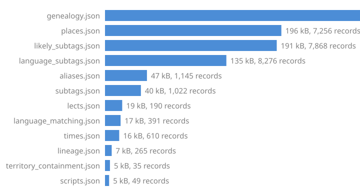

# Data and licence

<!-- agent-hint
covers: the data files that linguatag reads, how to regenerate them, and their licences.
source: linguatag/data/*.json, scripts/extract_cldr.py, scripts/add_nodes.py, NOTICE, LICENSE-CLDR
generated: no for the page. scripts/extract_cldr.py writes the five CLDR and IANA files, and scripts/add_nodes.py edits genealogy.json, places.json, times.json and lineage.json, so never edit the JSON by hand. scripts/docs_figures.py writes docs/figures/data-files.svg.
verify: python scripts/docs_figures.py --check && python scripts/check_doc_page.py docs/data-and-licence.md
see: ../NOTICE, ../LICENSE-CLDR
-->

This page lists the data files that linguatag reads, shows how to regenerate them, and gives their licences. linguatag reads all its data from JSON files in `linguatag/data`. It never reads the data of another installed package. Each file names its source in a `source` field.

## The data files

| File | Source | What reads it |
| --- | --- | --- |
| `likely_subtags.json` | CLDR 49 `supplemental/likelySubtags.json` | `maximize`, `default_region` and `likely_script` (UTS #35 section 4.3) |
| `aliases.json` | CLDR 49 `supplemental/aliases.json`: language, script, territory and variant aliases | canonical form (UTS #35 Annex C) |
| `subtags.json` | the IANA Language Subtag Registry, without the language records: each extlang, script, region and variant subtag and each grandfathered and redundant tag, with its Deprecated, Preferred-Value, Prefix, Suppress-Script and Macrolanguage fields | parsing and canonical form (RFC 5646) |
| `language_subtags.json` | the language records of the same registry, a file of their own so that a caller who reads no language record does not parse them | `standardize` (Suppress-Script), `closest_lang` and `standardize_lang` (Preferred-Value) |
| `language_matching.json` | CLDR 49 `supplemental/languageMatching.json`, `written-new`: paradigm locales, match variables and `languageMatch` rules | `lang_distance` (UTS #35 section 4.4) |
| `territory_containment.json` | CLDR 49 `supplemental/territoryContainment.json`: the regions in each macroregion | the region clusters of `lang_distance` |
| `lineage.json` | the orthography2ipa spec files at one commit | the `lects` argument |
| `genealogy.json` | the same spec files at one commit: the parent, weighted ancestors, family and clade flag of each tag | `parent`, `ancestors`, `family` and `ancestry_similarity` |
| `places.json` | the same spec files: the latitude and longitude of each tag | `geographic_distance` |
| `times.json` | the same spec files: the start and end year of each tag | `temporal_distance` and the temporal decay of `ancestry_similarity` |
| `lects.json` | the same spec files: the name of each private-use lect, with coverage lists that people fill | nothing yet; it holds the regions, islands and cities of each lect |
| `scripts.json` | the orthography2ipa script typology at the same commit | `script_distance` and `script_distance_by_name` |

The figure shows the size of each file and how many records it holds.



*Figure: the data files by size. `scripts/docs_figures.py` draws it from the files in `linguatag/data`. `genealogy.json` and `places.json` are the two largest.*

To see the source of each file:

```
$ python3 -c "import json, pathlib; [print(p.name, '|', json.loads(p.read_text())['source']) for p in sorted(pathlib.Path('linguatag/data').glob('*.json'))]"
aliases.json | CLDR 49, cldr-json cldr-core/supplemental/aliases.json
language_matching.json | CLDR 49, cldr-json cldr-core/supplemental/languageMatching.json, written-new
language_subtags.json | IANA Language Subtag Registry, File-Date: 2026-11-18
lects.json | TigreGotico/orthography2ipa@1c30a9d4af3f335653f08ffdd836c4fbb4ff98e5
likely_subtags.json | CLDR 49, cldr-json cldr-core/supplemental/likelySubtags.json
genealogy.json | TigreGotico/orthography2ipa@1c30a9d4af3f335653f08ffdd836c4fbb4ff98e5
lineage.json | TigreGotico/orthography2ipa@1e6e911705761de8d5724276187c4903ae92eaf4
places.json | TigreGotico/orthography2ipa@1c30a9d4af3f335653f08ffdd836c4fbb4ff98e5
scripts.json | TigreGotico/orthography2ipa@1c30a9d4af3f335653f08ffdd836c4fbb4ff98e5
subtags.json | IANA Language Subtag Registry, File-Date: 2026-11-18
territory_containment.json | CLDR 49, cldr-json cldr-core/supplemental/territoryContainment.json
times.json | TigreGotico/orthography2ipa@1c30a9d4af3f335653f08ffdd836c4fbb4ff98e5
```

Nobody edits these files by hand. `scripts/extract_cldr.py` regenerates the CLDR and IANA files. The genealogy, place, time and lect files are the source of truth: they were seeded once from the orthography2ipa commit that their `source` field names, and linguatag reads no orthography2ipa file. Change them with `scripts/add_nodes.py`.

## The loader is read-only

The package reads its data files with the internal call `linguatag._bcp47.load_data`, which is not part of the public API. It returns a read-only view of the parsed JSON. Dictionaries are frozen dicts and JSON arrays are tuples, so a caller cannot change package data for every other caller. The view is made once when the file is read and shared, so a repeated call costs no copy. `registry` returns a read-only view of the records of one kind, made the same way. The language records are in `language_subtags.json`, so `load_data("subtags.json")` holds no `language` key; read them with `registry("language")` or `load_data("language_subtags.json")`.

The view stays a dict, so JSON, copy and pickle work. A deep copy or an unpickled value is a plain, mutable dict. A shallow copy leaves the nested views frozen. To change package data for one call only, make a deep copy first.

```python
from linguatag import lect_steps
from linguatag._bcp47 import load_data  # internal: for contributors only

print(lect_steps("pt-x-central", "pt-x-minhoto"))  # 2
try:
    load_data("lineage.json")["parents"]["pt-x-central"] = "pt-x-minhoto"
except TypeError:
    print("TypeError")  # TypeError
print(lect_steps("pt-x-central", "pt-x-minhoto"))  # 2
```

## Regenerate the CLDR and IANA files

`scripts/extract_cldr.py` writes the first five files. It needs only the Python standard library. By default it downloads the CLDR 49 release of `cldr-json` and the IANA registry. Run it after a CLDR release or an IANA registry change.

1. Go to the root of a linguatag checkout.
2. Run the script:

   ```
   $ python3 scripts/extract_cldr.py
   likelySubtags: 7868 in, 7868 out
   languageAlias: 502 in, 502 out
   scriptAlias: 1 in, 1 out
   territoryAlias: 640 in, 640 out
   variantAlias: 2 in, 2 out
   registry: 9298 records in, 9298 out
   languageMatch: 381 in, 381 out
   territoryContainment: 46 in, 35 out (11 status entries left out)
   ```

3. Make sure that each "in" count agrees with its "out" count. The territory containment file leaves out the status entries on purpose.
4. Run `git diff --stat linguatag/data` to see which files changed.
5. Run the tests.

The counts change when the sources change. To read a source from a local file, give the paths in this order: likely subtags, aliases, IANA registry, language matching, territory containment. A missing argument takes the default URL:

```
python3 scripts/extract_cldr.py likelySubtags.json aliases.json language-subtag-registry languageMatching.json territoryContainment.json
```

To move to a different CLDR release, change the `CLDR_JSON` constant in the script.

## Add a language

Add a language or a lect as a pull request that changes `genealogy.json`, `places.json` and `times.json`. Do not edit the lines by hand. Write the facts to a JSON file and run `scripts/add_nodes.py`:

```json
{"pt-PT-x-ribatejo": {"parent": "pt-PT", "glottolog_code": null, "place": [39.24, -8.69]}}
```

```console
$ python scripts/add_nodes.py nodes.json
1 nodes in, 1 added, 0 updated
```

1. Give `parent` for each tag. The parent must be in the genealogy or in the same file.
2. Give `family_path` only when it is different from the family of the parent.
3. Give `glottolog_code` and `wikidata_qid` when you know them. Write `null` when the catalog has no entry for the variety. Leave the key out when no one checked.
4. Give `place` as `[latitude, longitude]` and `years` as `[start, end]`, where `start` is the year of the earliest attested distinct variety and `end` is `null` for a living language.
5. Write the source of each fact in the pull request.

The script refuses a tag that is not standard, a parent that the data does not hold, a cycle, a malformed glottocode or QID, and an unknown field. It refuses a tag that the data already holds, unless you give `--update`. An update changes only the keys that the file gives. When the parent changes, the update drops the weighted `ancestors` and takes the family of the new parent.

The tree models regional descent in more depth than Glottolog. A parent can differ from the Glottolog tree; `glottolog_code` keeps the link.

## Licences

linguatag is under the Apache License 2.0 ([LICENSE](../LICENSE)).

`linguatag/_bcp47.py` and `linguatag/_distance.py` port code from langcodes 3.5.1, Copyright (C) 2021 Robyn Speer, under the MIT License. The ported parts are `tag_parser.py`, `language_distance.py`, and the `Language.get`, `Language.maximize`, `Language.distance` and `standardize_tag` functions.

The four CLDR files hold Unicode CLDR release 49 data (cldr-json 49.0.0) under the Unicode License v3. The copyright is (C) 2015-2024 Unicode, Inc. [LICENSE-CLDR](../LICENSE-CLDR) holds the full notice.

`subtags.json` and `language_subtags.json` hold data from the IANA Language Subtag Registry. IANA and the IETF Trust dedicate their rights in the protocol registries to the public domain under CC0 1.0.

[NOTICE](../NOTICE) gives the full text of each attribution.

---
[Index](index.md) · [← Genealogy, place and time](genealogy.md) · [Performance →](performance.md)
