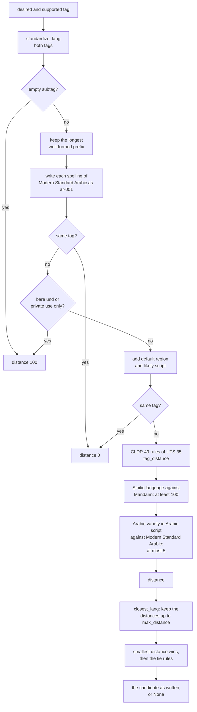

# Matching

<!-- agent-hint
covers: how lang_distance measures two tags and how closest_lang picks a tag from a list.
source: linguatag/matching.py:lang_distance, linguatag/matching.py:closest_lang, linguatag/distance.py:tag_distance, linguatag/data/language_matching.json
generated: no, but docs/figures/distance-ladder.svg comes from scripts/docs_figures.py. Edit the script, not the SVG
verify: python scripts/docs_figures.py --check && python scripts/check_doc_page.py docs/matching.md
see: dialects.md
-->

This page shows how linguatag decides whether a resource for one tag can serve a request for another.

`lang_distance` gives a number. `closest_lang` uses that number to pick from a list.

## A worked example

You have voices for `en-US` and `en-GB`, and a user asks for `en-AU`:

```python
from linguatag import closest_lang, lang_distance

print(lang_distance("en-AU", "en-US"))            # 5
print(lang_distance("en-AU", "en-GB"))            # 3
print(closest_lang("en-AU", ["en-US", "en-GB"]))  # en-GB
```

CLDR puts Australia in the same English cluster as Britain, so `en-GB` is nearer. With only `en-US` on hand, the answer is `en-US`, because 5 is a usable match:

```python
from linguatag import closest_lang

print(closest_lang("en-AU", ["fr-FR", "en-US"]))  # en-US
```

<!-- agent-hint: lang_distance and lang_matches are one-way. Pass the requested tag first. -->
## The steps of a match

`closest_lang` calls `lang_distance` once for each candidate. `lang_distance` runs the steps in the diagram, and the first step that ends the walk gives the number.



*Figure: the path of one pair of tags, top to bottom. The steps before the CLDR rules end the walk early for empty, identical and undetermined tags, and the two steps after them are the rules that linguatag adds to CLDR.*

## How the distance works

`lang_distance(desired, supported)` standardizes both tags and gives a tag with no region its default region. Then it adds the likely script, and measures the CLDR 49 matching distance of UTS #35 section 4.4. Each subtag that differs adds the distance of the first CLDR rule that matches it.

```python
from linguatag import lang_distance

print(lang_distance("pt", "pt-PT"))          # 0
print(lang_distance("pt", "pt-BR"))          # 5
print(lang_distance("en-CA", "en-US"))       # 4
print(lang_distance("en-CA", "en-GB"))       # 5
print(lang_distance("en-AU", "en-NZ"))       # 4
print(lang_distance("sr-Latn", "sr-Cyrl"))   # 5
print(lang_distance("zh-Hans", "zh-Hant"))   # 54
print(lang_distance("nb", "no"))             # 1
print(lang_distance("en", "fr"))             # 84
```

Two regions of one language are 4 apart, or 5 when CLDR puts them in two clusters. Canada is in the US English cluster. Every English region outside that cluster is 3 from `en-GB`, so `en-AU` is 3 from `en-GB` and 4 from `en-NZ`. Two scripts of one language are 50 apart unless a CLDR rule gives less, as for Serbian. Two languages are 80 apart unless a rule gives less, as for Norwegian Bokmål and Norwegian. A differing region adds to the script or language distance, so `zh-Hans` (China) and `zh-Hant` (Taiwan) are 54 apart.

The distance is not symmetric. CLDR has one-way rules, so a speaker of Swiss German accepts German, but not the reverse:

```python
from linguatag import lang_distance

print(lang_distance("gsw", "de"))   # 8
print(lang_distance("de", "gsw"))   # 84
```

## The distance ladder

The figure puts 13 pairs on one scale. The dashed line is `DEFAULT_MAX_LANGUAGE_DISTANCE`, 10.


*Figure: `lang_distance` of 13 pairs. Read the gap: none of these pairs falls between 10 and 54, which fits the rule that a different script is 50 apart and a different language is 80 apart.*

## The max_distance argument

`closest_lang` and `lang_matches` accept a candidate when its distance is `max_distance` or less. The default is `DEFAULT_MAX_LANGUAGE_DISTANCE`, which is 10. UTS #35 puts the threshold above a region difference (4) and below a script difference (50). The bound is inclusive, because CLDR gives 10 for a language against its macrolanguage.

```python
from linguatag import DEFAULT_MAX_LANGUAGE_DISTANCE, closest_lang, lang_matches

print(DEFAULT_MAX_LANGUAGE_DISTANCE)                       # 10
print(closest_lang("pt-BR", ["pt-PT"]))                    # pt-PT
print(closest_lang("pt-BR", ["pt-PT"], max_distance=0))    # None
print(lang_matches("en-AU", "en-US"))                      # True
print(lang_matches("en-AU", "en-US", max_distance=0))      # False
print(lang_matches("arz", "ar"))                           # True
print(lang_matches("ar", "arz"))                           # False
```

Pass `max_distance=0` to accept exact matches only. `lang_matches(a, b)` is `lang_distance(a, b) <= max_distance`, so it is also one-way.

## Ties

When two candidates have the same distance, `closest_lang` applies these rules in order:

1. A candidate that spells the requested tag itself, after `standardize_lang`, wins: `closest_lang("pt-PT", ["pt", "pt-PT"])` is `pt-PT`.
2. A candidate that writes the language with another code of it (a deprecated code or an extlang form) loses: `closest_lang("hak", ["hak", "zh-hak"])` is `hak`, and `closest_lang("zh-hak", ["hak", "zh-hak"])` is `zh-hak`.
3. A candidate with a language, extlang or region subtag that has an IANA Preferred-Value loses: `closest_lang("ar-apc", ["ajp", "apc"])` is `apc`, and `closest_lang("my-MM", ["my-BU", "my-MM"])` is `my-MM`.
4. A CLDR paradigm locale wins (`en-US`, `en-GB`, `es-ES`, `es-419`, `pt-BR`, `pt-PT`): `closest_lang("es-MX", ["es-CR", "es-419"])` is `es-419`.
5. Otherwise the first candidate in the list wins.

`standardize_lang` turns an ISO 639-2 code such as `fra` into `fr`, so `fra` spells `fr` for rule 1. It has no Preferred-Value, so rules 2 and 3 do not apply to it. The first of the two in the list wins:

```python
from linguatag import closest_lang

print(closest_lang("fr", ["fra", "fr"]))  # fra
print(closest_lang("fr", ["fr", "fra"]))  # fr
```

## und and private-use tags

A bare `und` names no language (RFC 5646 section 4.1). A script or region added to it says no more, so `und-Zzzz`, `und-ZZ` and `und-PT` all match `und`. Extensions and variants, such as `und-u-co-phonebk` and `und-1995`, are not locations and keep their own distance. A tag of private-use subtags only, such as `x-foo`, names only what its users agree on (section 4.6), and `und-x-foo` keeps its own identity. Surrounding whitespace is ignored. A collapsed tag or a private-use tag is 100 from a language tag:

```python
from linguatag import closest_lang, lang_distance

print(lang_distance("und", "en"))                    # 100
print(lang_distance("x-foo", "x-bar"))               # 100
print(lang_distance("und-ZZ", "und"))                # 0
print(lang_distance("und-Zzzz", "und"))              # 0
print(lang_distance("und-PT", "und"))                # 0
print(lang_distance("und-x-foo", "en"))              # 100
print(lang_distance("und-u-co-phonebk", "und"))      # 100
print(lang_distance("und-1995", "und"))              # 100
print(lang_distance("x-foo", "x-foo"))               # 0
print(closest_lang("und-US", ["und", "en-US"]))      # und
print(closest_lang(" und ", ["en-US", "und"]))       # und
```

## Arabic

An Arabic variety in Arabic script is at most 5 from Modern Standard Arabic (`ar`, `arb` or `ar-001`). The varieties are the individual languages of the `ar` macrolanguage, `ar` with any region, and Hassaniyya (`mey`). The spellings of Modern Standard Arabic are identical to each other:

```python
from linguatag import lang_distance

print(lang_distance("ar", "arb"))       # 0
print(lang_distance("arz", "ar"))       # 5
print(lang_distance("ar-MA", "ar"))     # 5
print(lang_distance("mey", "ar"))       # 5
print(lang_distance("pga", "ar"))       # 64
print(lang_distance("pga-Arab", "ar"))  # 5
```

CLDR alone gives 10 for `arz` against `ar` in one region. CLDR writes Juba Arabic (`pga`), Cypriot Maronite Arabic (`acy`) and Hassaniyya in Senegal (`mey-SN`) in Latin script, so they get the rule only with an explicit `-Arab` subtag. No other macrolanguage gets such a rule.

## Chinese

A spoken member of the `zh` macrolanguage other than Mandarin is a different language from `cmn`, and from `zh` in Simplified script. These members include Cantonese, Hakka, Min Nan, Wu, Gan and Xiang. `zh` in Traditional script keeps the CLDR distance, because a `zh-HK` resource is often Cantonese:

```python
from linguatag import closest_lang, lang_distance

print(lang_distance("yue", "cmn"))       # 100
print(lang_distance("hak", "zh-CN"))     # 100
print(lang_distance("yue-HK", "zh-HK"))  # 10
print(closest_lang("yue", ["zh-CN", "zh-HK"]))  # None
```

Literary Chinese (`lzh`) has no speakers, so this rule leaves it out. CLDR 49 writes it in Traditional script in China:

```python
from linguatag import lang_distance

print(lang_distance("lzh", "zh-Hant-CN"))  # 10
print(lang_distance("lzh-TW", "zh-Hant"))  # 10
print(lang_distance("lzh-Hans", "cmn"))    # 10
print(lang_distance("lzh", "zh-Hant"))     # 14
```

A bare `zh-Hant` is Taiwan, so a bare `lzh` is 14 from it. Fanti (`fat`) and Mandinka (`mnk`) match no other language, Akan (`ak`) and Mandingo (`man`) included. Twi (`tw`) is an alias of Akan, at distance 0.

---
[Index](index.md) · [← Likely subtags and default regions](likely-subtags.md) · [Dialects →](dialects.md)
