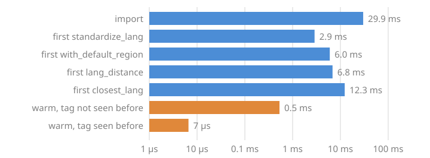

# Performance

<!-- agent-hint
covers: what the import and the first call of each main function cost, and what a warm call costs
source: scripts/docs_figures.py, docs/figures/timings.tsv, test/test_cold_start.py, functools.lru_cache in linguatag/_standardize.py and linguatag/_bcp47.py
generated: no, but docs/figures/call-timings.svg comes from scripts/docs_figures.py and docs/figures/timings.tsv from its --measure run. Edit the script, not the output
verify: python scripts/docs_figures.py --check && python scripts/check_doc_page.py docs/performance.md
see: matching.md, data-and-licence.md
-->

This page shows what the first call of each function costs, what a later call costs, and how to measure both on your own machine. The numbers come from one laptop, so read the shape, not the digits.

## The first call reads data

`import linguatag` reads two small files, `language_matching.json` and `territory_containment.json`. The first call of a function reads the other files that it needs, and later calls reuse them. In a fresh process, `standardize_lang("en")` reads `subtags.json` and `aliases.json`. The first `lang_distance` call also reads `likely_subtags.json`. Neither call reads `language_subtags.json`, because a tag with no alias needs none of its records.

This script times the import and the first call in a fresh process:

```python
import time

start = time.perf_counter()
import linguatag
imported = time.perf_counter() - start

start = time.perf_counter()
linguatag.lang_distance("en-AU", "en-US")
first = time.perf_counter() - start
```



*Figure: the median of 7 fresh processes for each call, on a log scale. Read the two colours: a first call costs milliseconds, and a warm call on a tag that the process already saw costs microseconds.*

## A warm call is cheap, and a repeated one is cheaper

`standardize_lang` caches its result for each tag, up to 4,096 tags. A call with a tag that the process saw before costs the cache lookup. A call with a tag that the process did not see costs a fraction of a millisecond.

A service that serves one language list loads once. Call `closest_lang` at start-up to pay the first call before the first request, or call it on each request and pay the first call once.

## Measure on your machine

From the root of a checkout, run:

```bash
python scripts/docs_figures.py --measure
```

The command times the calls in 7 fresh processes each and writes `docs/figures/timings.tsv`. `python scripts/docs_figures.py` then draws the figure from that file. `test/test_cold_start.py` checks which files a first call reads.

---
[Index](index.md) · [← Data and licence](data-and-licence.md) · [Reference →](reference.md)
